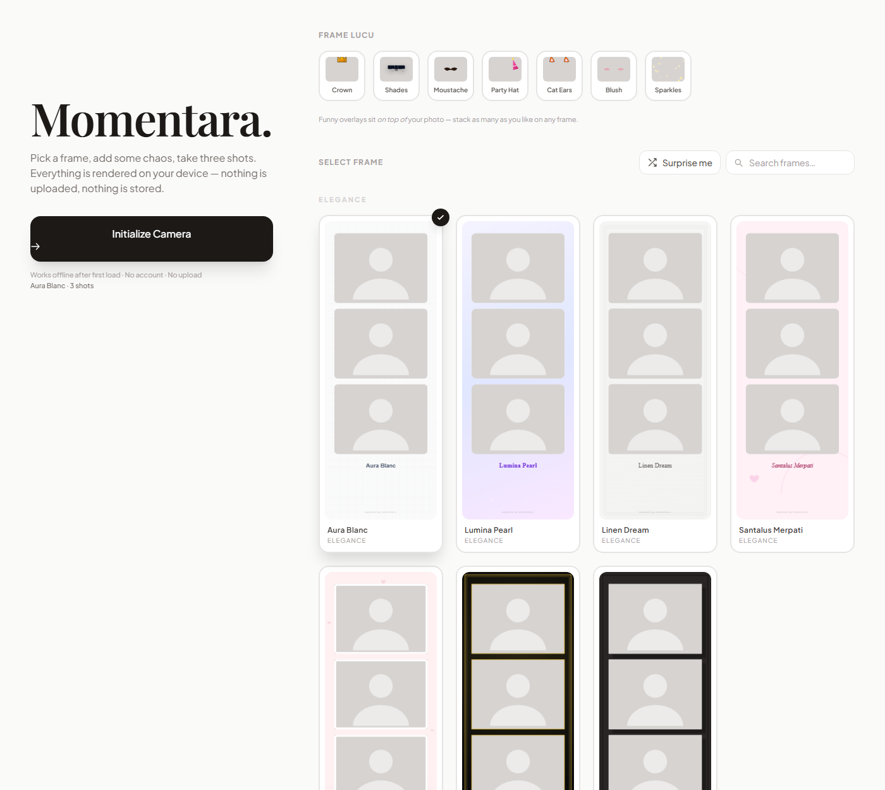
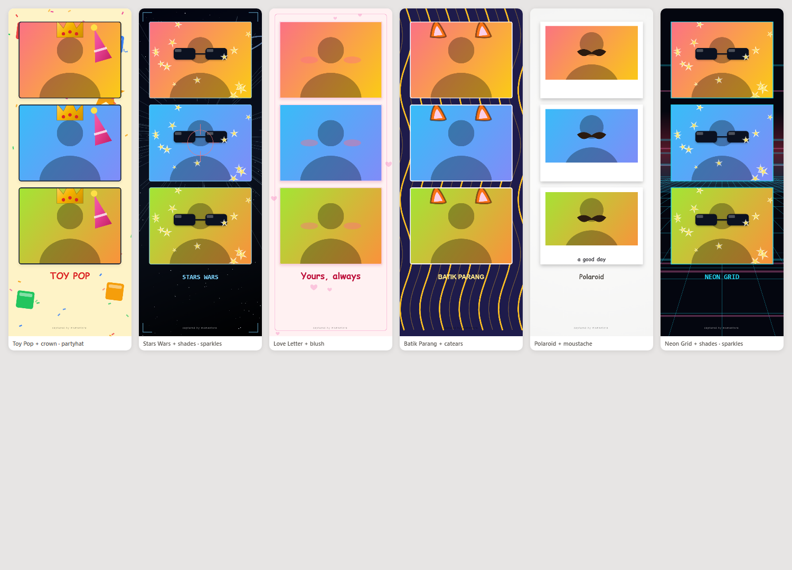

# Momentara

A photobooth that lives in a single HTML file. Pick a frame, stack some ridiculous overlays on top, tap once, and get a three-shot strip you can download. Everything renders locally on a `<canvas>` — no upload, no account, no server.





---

## Try it

```bash
git clone https://github.com/mhmmdrfisn/momentara.git
cd momentara
python -m http.server 8000     # or: npx serve, php -S localhost:8000, …
```

Open <http://localhost:8000>.

**A local server is required.** Browsers only expose `getUserMedia` on a secure origin, and `file://` does not qualify. `localhost` counts as secure, so the one-line server above is enough — you do not need HTTPS.

Everything else is optional. `index.html` is fully self-contained: open it directly and the frame gallery, search and previews all work; only the camera button needs a server.

---

## What it does

- **Three automated shots.** One tap, a 3-2-1 countdown per shot, white flash between frames.
- **38 frames**, grouped into Elegance, Fresh, Cosmic, Playful, Romance, Culture, Vintage and Minimal.
- **7 funny overlays** — crown, shades, moustache, party hat, cat ears, blush, sparkles — drawn *on top of* the photo. Stack as many as you like on any frame.
- **Live previews.** Each card is rendered by the exact same code that renders the final strip, so a preview can never lie about what you'll get.
- **Search** across frame names and groups, plus **Surprise me** for a random pick.
- **Retake** without reloading, and a download named after the frame you chose.
- **Remembers your last frame and overlays** in `localStorage`.
- Mirrors the preview by default (like a real mirror) and crops every shot to a consistent 4:3.

---

## How it's put together

There is no build step and no framework. `index.html` contains the markup, the styles, and one script that defines three things:

```
helpers    rr() seeded() star5() heart() leaf() …   drawing primitives
THEMES     38 entries                               frame definitions
OVERLAYS   7 entries                                on-photo marks
```

A theme is pure data plus two draw functions:

```js
batik: {
  name: 'Batik Parang',
  group: 'Culture',
  photo: { radius: 8, stroke: { color: '#F5F3FF', width: 4 } },
  bg(ctx, w, h) { /* paint the 600×1600 backdrop */ },
  title: { text: 'BATIK PARANG', font: `700 30px ${F_SANS}`, color: '#FDE68A' }
}
```

`composeStrip()` then runs: `bg()` → three `drawPhoto()` calls → optional `onTop()` → title → footer.

Two details worth knowing if you extend it:

- **Randomness is seeded.** Anything procedural calls `seeded(themeId)` rather than `Math.random()`, so the starfield and terrazzo chips land in the same place every time you re-render the same frame. That is what lets a preview match its output.
- **`photo` is a recipe, not a special case.** `{ mat, pad, radius, stroke, shadow }` is interpreted by one shared function, so the old copy-pasted `if (selectedTheme === 'velvet')` branches are gone.

### Adding a frame

Append an entry to `THEMES` and that's it — the gallery, previews, search, grouping and download filename all pick it up automatically. Reuse `lin()`, `rad()`, `star5()`, `heart()`, `leaf()`, `frond()`, `burst()`, `stars()` and `seeded()` rather than reaching for `Math.random()`.

### Adding an overlay

Append to `OVERLAYS` with a `label`, a `swatch` colour for the chip, and an `fn(ctx, w, h)` that draws in **photo-local coordinates** (`0,0` is the photo's top-left). `drawPhoto()` handles the clipping and the translate for you.

---

## Tests

Rendering is pure canvas code, so it can be checked without a browser and without a canvas library.

```bash
node tools/smoke-test.js    # every theme × {real, missing, partial} photos + every overlay
node tools/e2e-run.js       # drives real Chrome over CDP against a live camera
node tools/serve.js         # static server on :8123, required by the browser suites
```

`smoke-test.js` extracts the inline script straight out of `index.html`, runs it against a stub 2D context, and asserts every render path executes, every theme has a complete title spec, seeded RNGs are deterministic and distinct, and `rr()` survives degenerate sizes. It fails loudly on the first throw.

`e2e-run.js` launches headless Chrome over the DevTools protocol with a fake capture device, runs the full flow — select frame, toggle overlays, search, capture three frames, develop the strip, cancel, download — and checks the result view, the 600×1600 PNG dimensions, that overlay pixels really landed on the photo, that the camera track was released, and that the download anchor gets a `blob:` URL with a `.png` filename. It exits non-zero on any failure or uncaught console error, so it works as a CI gate. No npm dependencies: Node's built-in `WebSocket` is enough.

`tools/contact-sheet.html?mode=themes|overlays|all-overlays` renders every frame and overlay combination on one page for visual review. It reads `index.html` too, so it can't drift from the app.

---

## Privacy

Photos are never transmitted. They go from the camera straight into an offscreen canvas and out to a `blob:` URL for download. No network calls after the page loads, no analytics, no cookies. The only persisted state is your chosen frame and overlays, in `localStorage`, and clearing site data removes it.

The camera stream is released on capture, on cancel, on tab hide, and on `pagehide`, and an in-flight countdown is cancelled via a session token so a late timer can't fire into a view you've already left.

---

## Requirements

Any current Chrome, Edge, Firefox or Safari. Uses `getUserMedia`, `<canvas>`, `IntersectionObserver` (lazy previews) and `OffscreenCanvas`-free 2D context — all broadly supported. Tested on Chrome.

---

## License

[MIT](LICENSE) © 2026 Momentara contributors